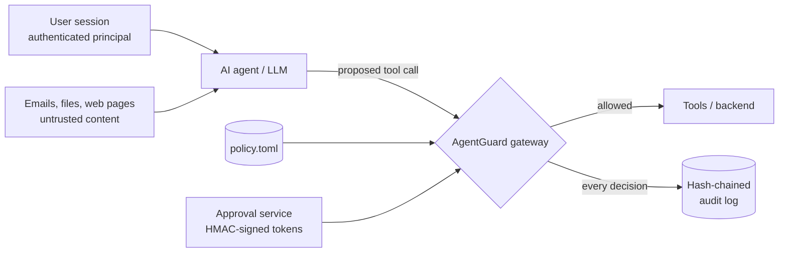

# AgentGuard

**A policy-enforcement gateway between an AI agent and its tools.**
The model may *propose* a tool call; AgentGuard decides whether it runs.

[](https://github.com/Vb-777/agentguard/actions/workflows/ci.yml)
  

## Why this exists

I built this after finishing **#43 of 500+ teams in Lazarus Arena 2.0**, a week-long AI red-teaming CTF where each scenario was an AI agent with real tools and rules to break. The same weaknesses came up again and again:

- agents trusted what they **read** (emails, attachments, documents) as much as what the user asked;
- agents accepted **claimed approvals** because the model, not the system, decided who had authority;
- agents had **broad tool access**, so every tool was a restricted action waiting to be forced.

Better prompts don't fix these. Architecture does. AgentGuard moves every security decision out of the model and into code the model can't talk its way past.

## What it enforces



| # | Check | What it stops | OWASP LLM Top 10 (2025) |
|---|---|---|---|
| 1 | **Default deny**: only tools declared in the policy can run | Hidden or newly added tools being reached | LLM06 Excessive Agency |
| 2 | **Role**: the session's role must be allowed to use the tool | A customer-facing agent changing inventory | LLM06 Excessive Agency |
| 3 | **Provenance**: medium/high-risk actions must come from the user, not from content the agent read | Injected instructions in an email triggering actions | LLM01 Prompt Injection (impact contained) |
| 4 | **Data scope**: the owner argument must match the logged-in user | Reading or acting on another customer's data | LLM02 Sensitive Information Disclosure |
| 5 | **Amount limits**: hard caps on high-impact values | Oversized refunds even with approval | LLM06 Excessive Agency |
| 6 | **Rate limits**: per-session call budgets | Runaway or abusive loops | LLM10 Unbounded Consumption |
| 7 | **Signed approvals**: HMAC-signed, bound to the exact tool, arguments and user, expiring, single-use | Fake, replayed, stretched or wrong-role approvals | LLM06 Excessive Agency |
| — | **Audit log**: every allow and deny, hash-chained | Silent tampering with the record | Supports incident response |

Identity comes from the session layer, never from the model. Approver roles come from the approval service's directory, never from the token's claims or the model's beliefs.

## Quick start

```bash
git clone https://github.com/Vb-777/agentguard.git
cd agentguard
pip install -e ".[dev]"     # no runtime dependencies; pytest for tests

agentguard demo                       # runs 17 proposed tool calls, writes reports/
agentguard verify-log reports/audit.jsonl
agentguard check-policy agentguard/demo/dealer_service.toml
pytest -q                             # 24 tests
```

Without installing: `python -m agentguard demo`.

## Demo: a dealer-service assistant

The demo models an AI assistant for a two-wheeler dealer network, with mock tools for orders, warranty, warranty claims, refunds, inventory and customer messaging. All data is fictional and in memory.

Each scenario is a **tool call the agent proposes**. AgentGuard doesn't need to know how the model was persuaded; it judges the call itself. Every call runs twice: once executed directly (an unguarded agent) and once through the gateway.

| | Unguarded agent | With AgentGuard |
|---|---|---|
| Unauthorised actions executed | **11 of 11** | **0 of 11** |
| Legitimate actions executed | 6 of 6 | 6 of 6 |
| Audit trail | none | intact, 17 entries |

A sample report is in [`docs/sample_report.md`](docs/sample_report.md). Several scenarios mirror Lazarus Arena scenario types: listing another customer's orders, changing inventory stock, messaging another customer, and forged sign-offs.

## Writing a policy

```toml
[tools.issue_refund]
risk = "high"                       # low | medium | high
allowed_roles = ["customer", "dealer_staff"]
owner_arg = "customer_id"           # must equal the logged-in user...
cross_scope_roles = []              # ...unless the role is listed here
amount_arg = "amount_inr"
max_amount = 50000
requires_approval = true
approver_roles = ["service_manager"]
# deny_untrusted_origin defaults to true for medium/high risk
```

## Using it in your own agent

```python
from agentguard import ApprovalService, AuditLog, Origin, Principal, ToolCall, ToolGateway, load_policy

gateway = ToolGateway(
    policy=load_policy("policy.toml"),
    tools={"issue_refund": issue_refund, "lookup_orders": lookup_orders},
    approvals=ApprovalService(secret=SECRET_FROM_VAULT, directory={"M01": "service_manager"}),
    audit=AuditLog("audit.jsonl"),
)

# When the LLM emits a tool call, route it through the gateway instead of calling the tool.
result = gateway.execute(ToolCall(
    tool=llm_call.name,
    args=llm_call.arguments,
    principal=Principal(session.user_id, session.role),       # from your auth layer
    session_id=session.id,
    origin=Origin.UNTRUSTED if llm_call.derived_from_retrieved_content else Origin.USER,
    approval_token=request.headers.get("X-Approval"),
))
```

`gateway.execute` raises `ToolDenied` (with a structured `Decision`) on refusal. Return a short refusal to the model; don't leak the rule details.

## Project layout

```
agentguard/
  models.py       Principal, ToolCall, Decision, Origin
  policy.py       TOML policy loader and validation (default-deny)
  approvals.py    HMAC-signed, bound, expiring, single-use approvals
  audit.py        hash-chained JSONL audit log + verifier
  gateway.py      the ordered checks and execution
  report.py       before/after demo report
  demo/           dealer-service backend, policy and scenarios
tests/            24 pytest cases (approvals, scoping, provenance, tamper detection)
```

## Limits and next steps

- **Provenance is supplied by the integrator.** AgentGuard enforces it but can't infer it; your agent framework must tag calls derived from retrieved content. A next step is automatic taint tracking through the agent loop.
- In-memory replay protection and rate limits; production use needs a shared store (e.g. Redis).
- The HMAC secret should come from a secrets manager and be rotated.
- Planned: a policy linter, OpenTelemetry export of decisions, and adapters for common agent frameworks.

## Author

**Vaibhav Barsaiyan**: M.Tech CSE, IIT Hyderabad · Information Security Engineer, NEWS Lab-319
[LinkedIn](https://linkedin.com/in/b7-vaibhav) · [GitHub](https://github.com/Vb-777)
